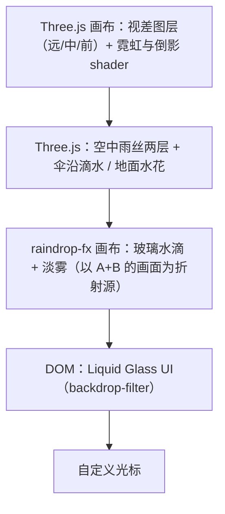

# 雨夜个人主页 · 实施方案（rain-home）

## 已确认的决策

| # | 问题 | 决定 |
|---|---|---|
| 1 | 页面结构 | 沉浸式首屏，向下滚动进入各分区。背景固定不动，滚动时镜头推近，雨势和景深随之变化 |
| 2 | 立体感 | 拆成 3 层视差：远景城市 / 中景人群 / 前景人物和伞 |
| 3 | 雨水 | 空中两层雨丝 + 屏幕玻璃水滴和淡雾 + 鼠标擦雾、点击出涟漪 + 伞沿滴水、地面水花 |
| 4 | UI | visionOS / iOS 26 的 Liquid Glass 风格。配色用图里的冷蓝灰，霓虹暖粉做点缀 |
| 5 | 性能 | 低配设备自动降级，提供静态兜底，跟随系统「减少动态效果」设置，右下角有特效开关 |
| 6 | 工程 | 零构建纯静态站，Three.js 放在本地 vendor 目录，可以直接用 GitHub Pages 部署 |
| 7 | 内容 | 中文为主，英文小标题点缀。分区：首屏 → 关于 → 作品 → 技能 → 经历 → 联系。所有内容集中写在 `data.js` 里 |
| 8 | 细节 | 顶部玻璃导航胶囊 + iPadOS 式吸附光标。**不做**开场动画，**不做**耳机彩蛋 |
| 9–10 | 素材 | 高清图和拆层素材由你提供。我现在先用 1024 原图当单层占位，把全部效果跑通 |

## 目录结构

```
d:\html_personal\rain-home\
├─ index.html              # 页面骨架 + import map（three → ./vendor/three.module.js）
├─ css/style.css           # Liquid Glass 设计变量、分区、响应式
├─ js/
│  ├─ config.js            # 集中配置：图层列表、雨丝、水滴、视差强度、降级阈值
│  ├─ data.js              # 个人信息占位（名字、简介、作品、技能、经历、联系方式）
│  ├─ main.js              # 启动入口、能力检测、降级、特效开关
│  ├─ scene/
│  │  ├─ background.js     # 视差图层平面 + 霓虹呼吸 / 地面倒影波动 / 景深 shader
│  │  ├─ rain.js           # 由 personal/js/rain.js 移植为 Three.js ShaderMaterial
│  │  ├─ splash.js         # 伞沿滴水、地面水花（InstancedMesh 粒子）
│  │  ├─ ripple.js         # 点击涟漪（屏幕空间折射扰动）
│  │  └─ drops.js          # 改写自 personal/js/drops.js 的 raindrop-fx 适配层
│  ├─ ui/
│  │  ├─ cursor.js         # 圆点 + 玻璃光圈，悬停可点击元素时吸附变形
│  │  ├─ glass.js          # 卡片随鼠标 3D 倾斜、高光跟随、按压弹性
│  │  ├─ nav.js            # 顶部导航胶囊，高亮滑块跟随当前分区
│  │  └─ sections.js       # 渲染 data.js、滚动渐显、作品详情弹层
├─ vendor/                 # three.module.js、three.core.js、raindrop-fx.js 及各自许可证
├─ assets/bg/              # 背景素材
└─ README.md               # 部署说明、素材替换说明、参数说明
```

## 渲染分层（从下到上）



- **视差**：每层图片放在一张平面上，按深度设置位移系数。鼠标位置和滚动进度驱动相机，用 lerp 平滑插值。滚动时相机推近，景深焦点在人物和城市之间移动。
- **背景 shader**：用一张亮度遮罩（从图中的霓虹高光区提取）控制灯光呼吸闪烁。画面下半部的湿地面加一层随时间流动的折射噪声，模拟倒影波动。
- **雨丝**：保留原 `rain.js` 的参数，包括 `count / speed / len / width / slant / alpha`。滚动越深雨越密，鼠标附近的雨丝会被推开一点。
- **玻璃水滴**：继续用 `personal` 里打过补丁的 raindrop-fx 和 `dt=0.03` 的步进方式。折射源改为 Three.js 渲染出的画面。
- **擦雾**：raindrop-fx 本身没有擦雾功能。我另做一张擦除遮罩纹理，鼠标划过时写入，然后随时间恢复，并在雾气 pass 里乘上这张遮罩。
- **涟漪**：点击时在 shader 里叠加一圈环形法线扰动，让背景和雨丝产生折射，同时在 DOM 层显示一圈微光。

## UI 设计

- 玻璃材质：`backdrop-filter: blur(24px) saturate(160%)`，渐变描边做边缘高光，内阴影做厚度，鼠标位置用径向高光跟随。
- 交互反馈：悬停时卡片轻微抬起，并按 ±6° 做 3D 倾斜。按下时缩到 0.97，松开时用弹簧曲线回弹。所有过渡使用苹果式 easing `cubic-bezier(.2,.8,.2,1)`。
- 字体：`-apple-system, "SF Pro", "PingFang SC", "Microsoft YaHei"`。首屏名字用大字号细字重。
- 作品弹层：卡片放大成详情页，用 FLIP 动画实现，背景同时变暗变模糊。

## 降级策略

| 条件 | 行为 |
|---|---|
| 桌面端，FPS ≥ 45 | 开启全部效果 |
| 移动端，或 FPS 持续 < 45 | 关闭玻璃水滴和拆层视差，雨丝减半，DPR 上限降到 1.5 |
| 不支持 WebGL | 显示静态背景图 + CSS 雨丝 |
| 系统开启「减少动态效果」 | 静态背景，保留轻量雨丝，取消倾斜和弹簧动画 |
| 右下角开关 | 可以手动关闭或开启特效 |

## 素材规格（请按这个准备）

| 文件 | 内容 | 要求 |
|---|---|---|
| `assets/bg/full.jpg` | 完整背景 | 建议 2560×1440 及以上，16:9 |
| `assets/bg/layer-far.png` | 远景城市和霓虹 | 与 full 同尺寸，不需要透明 |
| `assets/bg/layer-mid.png` | 中景人群和湿地面 | 透明 PNG，被前景遮挡的区域要补绘 |
| `assets/bg/layer-near.png` | 人物和伞 | 透明 PNG |
| `assets/bg/neon-mask.png`（可选） | 霓虹发光区域 | 灰度图，白色表示会发光 |

素材到位前，`config.js` 里的 `layers` 只放 `full.jpg` 一张，视差会退化成整图轻微平移。素材到了，把三层加进 `config.js` 就能生效。

## 验证计划

- 用本地静态服务预览，检查 1920×1080、1366×768、390×844 三种尺寸的截图。
- 检查控制台没有报错，资源都用相对路径，放在仓库子路径下也能加载。
- 检查降级分支：模拟不支持 WebGL 的情况，以及开启「减少动态效果」的情况。
